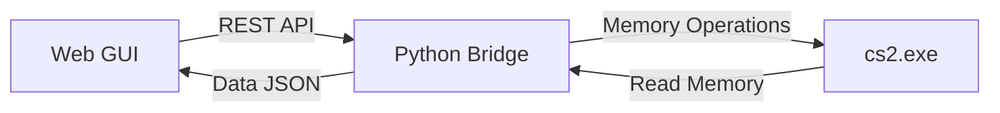

# CS2 Companion

A premium, feature-rich enhancement suite for Counter-Strike 2, designed with a focus on industrial-grade stability, humanized inputs, and a sophisticated modern interface.

## 🛡️ Project Overview
CS2 Companion is a client-side augmentation tool that provides advanced telemetry and gameplay assistance. Unlike simple scripts, this project utilizes a **Bridge Architecture**, separating the visualization layer (React-based Web UI) from the memory which allows for a clean, modular development process and decreased detection risk.

## ✨ Key Features

### Visual Enhancements (ESP)
*   **Skeleton ESP:** Renders a human silhouette for all entities in the world.
*   **Health & Armor Bars:** Precise visual indicators for survival.
*   **Glow V2:** High-visibility outlines for recognized entities.
*   **Visibility Checking:** Intelligent filtering to show only players visible from the current POV.
*   **Referee/Spectator List:** Real-time tracking of active observers.

### Combat Assistance
*   **Humanized Aimbot V2:** Utilizes a `SmoothDamp` algorithm to mimic natural mouse movement rather than synthetic snapping.
*   **Priority Bone Selection:** Intelligence logic to prioritize helplessly vulnerable hitboxes (Head $\rightarrow$ Chest $\rightarrow$ Pelvis).
*   **Triggerbot:** Precise timing-based input linked to crosshair ID recognition.
*   **Anti-Recoil:** Soft and Hard options to stabilize weapon spread during sustained fire.

### Movement & Utility
*   **BunnyHop:** Automated jump synchronization for speed maintenance.
*   **Bomb & Nade Helper:** Visual timers for explosion and defuse sequences.
*   **Radar 2D:** An expanded top-down circular view of the local game environment.

---

## 🏗️ Architecture

The system is Divided into two primary tiers to ensure lightweight performance and stability:



- **The Frontend (`/web`):** A modern React application utilizing Tailwind CSS for styling and Framer Motion for high-fidelity animations.
- **The Bridge (`/bridge`):** A lightweight Python service that handles process attachment and memory offsets.

---

## 🛠️ Installation & Setup

### 1. Project Structure
```text
/cs2-companion/
├── /bridge/                # Python/Pymem memory bridge logic
└── /web/                   # Premium React interface
```

### 2. Getting Started
1. **Clone the repository:**
   ```bash
   git clone https://github.com/tussle1/cs2-companion.git
   cd cs2-companion
   ```

2. **Launch the Bridge:**
   ```bash
   cd bridge
   pip install fastapi uvicorn pymem
   python main.py
   ```

3. **Launch the GUI:**
   ```bash
   cd web
   npm install
   npm run dev
   ```

---

## 🎨 Design Philosophy
The UI/UX is engineered to be:
- **Immediate:** Low-latency activation (<200ms).
- **Elegant:** Deep charcoal palettes with selective accent glows.
- **Intuitive:** Tabbed categories and custom-built interaction components.
- **Lightweight:** Optimized for minimal CPU impact while running in the background.

---

## 📄 License
This project is open-source and available for educational use. 
